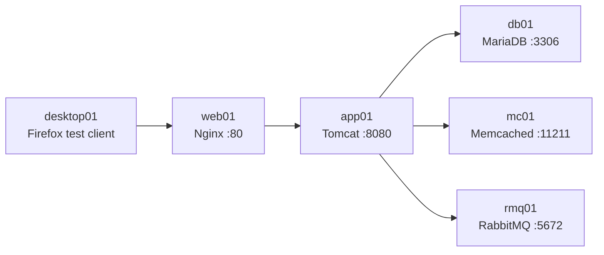
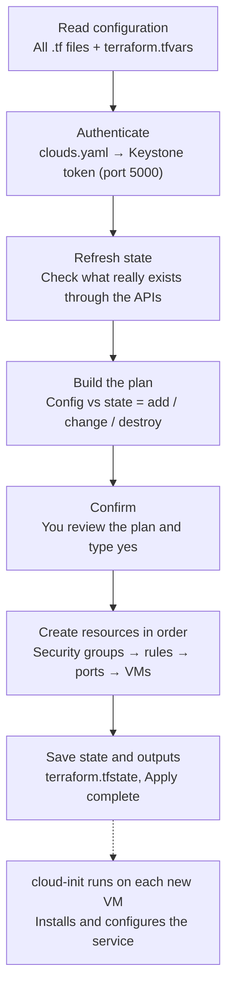
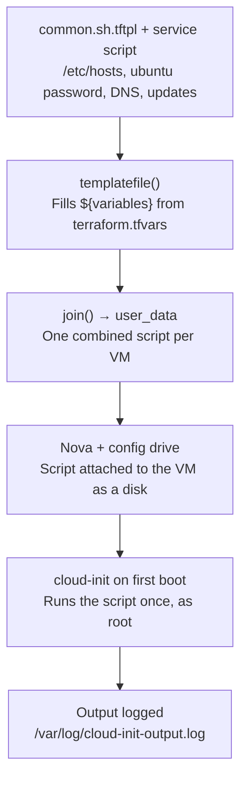

# vprofile on OpenStack with Terraform

Provisioning flow, configuration and troubleshooting for the five-tier **vprofile** application on Raya Cloud (`api07-egy.rayacloud.com`). This project replaces the manual Vagrant steps of the original *VprofileProjectSetup* guide.

## Contents

1. [Overview](#1-overview)
2. [One-time workstation setup](#2-one-time-workstation-setup)
3. [Project files](#3-project-files)
4. [How `terraform apply` works](#4-how-terraform-apply-works)
5. [How the scripts reach the VMs](#5-how-the-scripts-reach-the-vms)
6. [From the manual guide to the automated project](#6-from-the-manual-guide-to-the-automated-project)
7. [Provisioning the VMs one by one](#7-provisioning-the-vms-one-by-one)
8. [Problems solved during setup](#8-problems-solved-during-setup)
9. [Tearing down](#9-tearing-down)
10. [Git hygiene](#10-git-hygiene)

---

## 1. Overview

The original vprofile setup builds five VMs with Vagrant and VirtualBox, then configures each one by hand: installing packages, editing config files and opening firewall ports. This project does the same on OpenStack with every manual step automated. Terraform creates the network ports, security groups and VMs, and each VM configures itself on first boot by running a shell script through cloud-init.



All VMs run Ubuntu 24.04 on the `internal` network, with outbound internet access through the router.

| VM | Service | Port | Script | Used by |
|---|---|---|---|---|
| db01 | MariaDB (MySQL) | 3306/tcp | `mysql.sh.tftpl` | app01 |
| mc01 | Memcached | 11211/tcp, 11111/udp | `memcache.sh.tftpl` | app01 |
| rmq01 | RabbitMQ | 5672/tcp | `rabbitmq.sh.tftpl` | app01 |
| app01 | Tomcat 9 + vprofile app | 8080/tcp | `tomcat.sh.tftpl` | web01 |
| web01 | Nginx reverse proxy | 80/tcp | `nginx.sh.tftpl` | Users / desktop01 |
| desktop01 | XFCE + Firefox (optional) | 22, 3389/tcp | `desktop.sh.tftpl` | You, for testing |

---

## 2. One-time workstation setup

Terraform reads its OpenStack credentials from `~/.config/openstack/clouds.yaml`. The entry must use the **public API hostname** from the service catalog. The internal address (`10.250.77.63`) is not reachable from outside, and the TLS certificate is valid only for `*.rayacloud.com`, not for IP addresses.

```yaml
clouds:
  openstack:
    auth:
      auth_url: https://<public-api-hostname>:5000/v3   # e.g. https://api.example.com:5000/v3
      username: "<your-username>"
      project_id: <your-project-id>
      project_name: "admin"
      user_domain_name: "Default"
    region_name: "RegionOne"
    interface: "public"
    identity_api_version: 3
```

A network device between the workstation and the cloud breaks the larger TLS handshake that recent Go versions send (post-quantum key exchange). Terraform is written in Go, so it must run with that feature turned off. Certificate checks stay fully enabled. Add both lines to `~/.bashrc`:

```bash
export GODEBUG=tlsmlkem=0
export OS_CLOUD=openstack
```

Verify access:

```bash
openstack token issue -c expires
openstack network list
```

---

## 3. Project files

| File | Purpose |
|---|---|
| `provider.tf` | Terraform and OpenStack provider versions; the provider reads the cloud named in `var.os_cloud`. |
| `variables.tf` | All inputs with defaults: images, flavors, network, VM selection, application passwords, Java version. |
| `terraform.tfvars` | Your actual values. Terraform loads this file automatically; `terraform.tfvars.example` is only a reference. |
| `security.tf` | Security groups that replace every firewalld step of the manual guide. |
| `main.tf` | Looks up the network, keypair, image and flavors; creates one port and one VM per selected service. |
| `desktop.tf` | Optional desktop01 VM with its own security group and boot volume. |
| `outputs.tf` | Prints VM IPs and connection hints after apply. |
| `scripts/*.tftpl` | Shell templates run by cloud-init on first boot; `${...}` placeholders are filled from variables. |

Key settings in `terraform.tfvars`:

```hcl
os_cloud              = "openstack"
image_name            = "Ubuntu 24.04 LTS (old-20260712)"
flavor_name           = "e1.small"
app_flavor_name       = "c2r4"        # 0 GB disk -> boots from a 20 GB volume automatically
network_name          = "internal"
key_pair_name         = "n-keypair"   # must be type ssh, not x509
external_network_name = ""            # no floating IPs; internal network already has internet
java_version          = "11"          # the app uses Spring 4.2, which fails on Java 17

vm_names       = ["web01", "db01"]    # VMs to create; empty list = all five
enable_desktop = true
```

---

## 4. How `terraform apply` works

Every run follows the same sequence. Terraform first compares what your files describe with what actually exists in the cloud, shows you the difference, and only then makes changes. The final step, cloud-init, runs inside the VM **after** Terraform has finished, so a successful apply does not yet mean the software is installed.



Resources are created in dependency order. Ports are created before VMs, so every VM already knows the IP addresses of all selected VMs when it boots. Those addresses are written into `/etc/hosts`, which replaces the vagrant-hostmanager plugin.

---

## 5. How the scripts reach the VMs

Each VM receives two scripts joined together: a common part used by every VM, and the service script for its role. Terraform fills in the placeholders, and OpenStack delivers the result on a **config drive** (a small virtual disk), because the metadata service is not reachable from the VMs.



The relevant part of `main.tf`:

```hcl
user_data = join("\n", [
  templatefile("${path.module}/scripts/common.sh.tftpl", local.common_vars),
  templatefile("${path.module}/scripts/${each.value.script}", local.script_vars),
])
```

### Rules for editing scripts

| Rule | Why |
|---|---|
| Write bash variables as `$${NAME}` | Terraform treats every `${...}` as its own placeholder; `$${...}` outputs a literal `${...}`. A plain `$NAME` without braces is fine. |
| Start with `#!/bin/bash` and `set -e` | The first failing command stops the script and is easy to find in the log. |
| Rebuild the VM after editing its script | cloud-init runs only on first boot, and `ignore_changes = [user_data]` keeps Terraform from rebuilding VMs on its own. Use `terraform apply -replace='openstack_compute_instance_v2.vm["app01"]'`. |

---

## 6. From the manual guide to the automated project

The original guide targets CentOS; this project runs Ubuntu 24.04 everywhere, so the scripts use the Ubuntu equivalent of each manual step.

| Manual step (CentOS) | Automated equivalent (Ubuntu 24.04) |
|---|---|
| `vagrant up` + vagrant-hostmanager | `terraform apply`; `/etc/hosts` written from the port IPs |
| `yum update` / `yum install`, `epel-release` | `apt-get update` / `apt-get install` (no EPEL needed) |
| `firewall-cmd --add-port=...` | Security group rules in `security.tf` (only VMs in `vprofile-internal-sg` may connect) |
| `mysql_secure_installation` (interactive) | Scripted SQL in `mysql.sh.tftpl`: root password, remove anonymous users and test DB |
| MariaDB listens on all interfaces | `bind-address = 0.0.0.0` in `/etc/mysql/mariadb.conf.d/50-server.cnf` |
| `sed` on `/etc/sysconfig/memcached` | `-l 0.0.0.0` and `-U 11111` in `/etc/memcached.conf` |
| `centos-release-rabbitmq-38` repo | `rabbitmq-server` from the Ubuntu repositories |
| `java-11-openjdk` | `openjdk-${java_version}-jdk` with `java_version = "11"` |
| `vim application.properties` | Backend hostnames written by `tomcat.sh.tftpl` before `mvn install` |
| `vi /etc/nginx/sites-available/vproapp` | Same upstream config (`app01:8080`) written by `nginx.sh.tftpl` |

---

## 7. Provisioning the VMs one by one

Follow the order of the manual guide, adding one VM per apply. Each new VM learns the addresses of the VMs created before it, so app01, created after the three backends, can reach all of them by name.

> **Always keep VMs that already exist in `vm_names`.** Removing a name destroys that VM. Check the plan before every apply.

```bash
cd ~/terraform/vprofile-v1
terraform plan -parallelism=2 | grep -E "will be|must be|Plan:"
terraform apply -parallelism=2
```

`-parallelism=2` reduces bursts of API connections, which a firewall on the path has blocked temporarily before.

Log in to a VM through **Dashboard → Instances → Console** as `ubuntu` with your `ubuntu_password`. On every VM, the first check is:

```bash
sudo cloud-init status --long        # want: status: done, errors: []
```

### Step 1: db01 (MariaDB)

Installs MariaDB, secures it, creates the `accounts` database and the `admin` user, clones the repository and loads `db_backup.sql`.

```hcl
vm_names = ["web01", "db01"]
```

Verify on the VM:

```bash
systemctl status mariadb --no-pager
sudo mysql -u root -padmin123 -e "show tables;" accounts
sudo ss -tlnp | grep 3306              # must show 0.0.0.0:3306
```

### Step 2: mc01 (Memcached)

Installs memcached and makes it listen on all interfaces on TCP 11211 and UDP 11111.

```hcl
vm_names = ["web01", "db01", "mc01"]
```

Verify on the VM:

```bash
systemctl status memcached --no-pager
sudo ss -tlnup | grep -E "11211|11111" # 0.0.0.0, not 127.0.0.1
```

### Step 3: rmq01 (RabbitMQ)

Installs `rabbitmq-server`, allows non-localhost logins and creates the administrator user `test`.

```hcl
vm_names = ["web01", "db01", "mc01", "rmq01"]
```

Verify on the VM:

```bash
systemctl status rabbitmq-server --no-pager
sudo rabbitmqctl list_users            # test [administrator]
sudo ss -tlnp | grep 5672
```

### Step 4: app01 (Tomcat and the application)

Installs Java 11, Maven and Tomcat 9.0.75, writes the backend hostnames into `application.properties`, builds the WAR with `mvn install` and deploys it as `ROOT.war`. Because `c2r4` has 0 GB disk, Terraform boots app01 from a 20 GB volume. The build takes 10 to 20 minutes; until it finishes, Tomcat shows its default welcome page.

```hcl
vm_names = ["web01", "db01", "mc01", "rmq01", "app01"]
```

Verify on the VM:

```bash
java -version                          # 11.0.x
getent hosts db01 mc01 rmq01
nc -zv db01 3306; nc -zv mc01 11211; nc -zv rmq01 5672
sudo ls -l /usr/local/tomcat/webapps/  # ROOT.war about 54 MB
curl -I localhost:8080                 # 200 or 302
```

### Step 5: Refresh web01 (Nginx)

web01 was created first, so its `/etc/hosts` does not contain app01 and nginx cannot reach it. Rebuild it to write the complete hosts list. Do the same for desktop01 if you want to reach the VMs by name from Firefox.

```bash
terraform apply -parallelism=2 -replace='openstack_compute_instance_v2.vm["web01"]'
terraform apply -parallelism=2 -replace='openstack_compute_instance_v2.desktop[0]'   # optional
```

Verify on web01:

```bash
grep app01 /etc/hosts
systemctl status nginx --no-pager
curl -I localhost                      # 200 or 302, no longer 502
```

### Step 6: End-to-end test

From desktop01, open Firefox at `http://web01` and log in with `admin_vp` / `admin_vp`. A successful login exercises the whole chain: nginx → Tomcat → MariaDB, with Memcached caching and RabbitMQ messaging.

---

## 8. Problems solved during setup

| Symptom | Cause | Fix |
|---|---|---|
| `x509: certificate signed by unknown authority`; browser shows Kaspersky as issuer | Kaspersky on Windows re-signs HTTPS traffic for inspection; the browser view is not the real certificate. | Fetch the real certificate from the Terraform machine with `openssl s_client`. It is a DigiCert certificate that Ubuntu already trusts, so no CA file is needed. |
| Connection to `10.250.77.63:5000` hangs | Internal Keystone endpoint, not reachable from outside. | Use the public endpoint from the service catalog: `api07-egy.rayacloud.com`. |
| Certificate not valid for the IP | The certificate covers `*.rayacloud.com` only. | Always connect by hostname, never by IP. |
| `EOF` on `POST /v3/auth/tokens` via `portal07-egy` | `portal07-egy` is the dashboard host; its port 5000 is not a reliable API endpoint. | Use `api07-egy`, which the catalog lists for every service. |
| CLI and curl work but Terraform fails TLS | Go sends a larger post-quantum TLS handshake that a device on the path mishandles. | `export GODEBUG=tlsmlkem=0` (certificate checks remain on). |
| Service ports time out after many requests | A firewall briefly blocks bursts of parallel connections. | Wait a few minutes; run plan/apply with `-parallelism=2`. |
| `403: Only volume-backed servers are allowed for flavors with zero disk` | Flavor `c2r4` has 0 GB local disk. | Terraform looks up each flavor; 0 GB disk → boot from a Cinder volume (`vm_volume_size`, `desktop_volume_size`). |
| Tomcat 404 at `/`; log shows `InaccessibleObjectException ... java.lang.invoke` | Spring 4.2 / Spring Data 1.x reflection is blocked by Java 17. | `java_version = "11"` and rebuild app01. |
| Plan shows unexpected resources (old `10.10.10.x` IPs) | `terraform.tfstate` came from an earlier deployment in another cloud. | Destroy against the old cloud, or move the old state aside before the first apply. |
| Extra `*:Zone.Identifier` files | Windows download markers copied into WSL. | `find . -name '*Zone.Identifier' -delete`; copy files with `cp` from `/mnt/c` instead. |
| `Essam-KeyPair` cannot log in | It is an x509 keypair, not an SSH key. | `key_pair_name = "n-keypair"`. |

### Where to look when a VM misbehaves

```bash
openstack console log show <vm> | tail -40              # from your workstation, no login
sudo cloud-init status --long                            # on the VM
sudo tail -60 /var/log/cloud-init-output.log             # what the script printed
sudo grep -iE "error|fail|denied" /var/log/cloud-init-output.log
sudo journalctl -u tomcat --no-pager | grep -E "SEVERE|Exception"   # app01
```

---

## 9. Tearing down

To remove one VM, delete its name from `vm_names` and apply. To remove everything, including security groups, ports, boot volumes and the desktop image:

```bash
terraform destroy -parallelism=2
```

Review the list Terraform prints before typing `yes`. Boot volumes are deleted with their VMs because `delete_on_termination = true`.

---

## 10. Git hygiene

Some files in this project contain passwords or machine-specific data and must not be committed. Your `.gitignore` should include at least:

```gitignore
# Terraform working files
.terraform/
*.tfstate
*.tfstate.*
crash.log

# Real values, including passwords (commit terraform.tfvars.example instead)
terraform.tfvars
*.auto.tfvars

# Local leftovers
*Zone.Identifier
chain.pem
old-state/
```

Commit `.terraform.lock.hcl`: it pins the provider version so everyone uses the same one.
